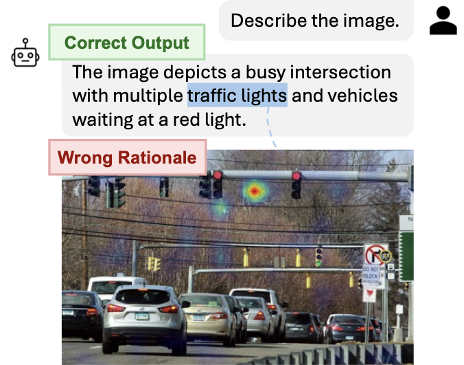

<div align="center">

# VIGOR

**Benchmarking Visual Rationale Correctness<br>in Multimodal Large Language Models**

Yanlin Chen · Tang Li · Xi Peng

**NeurIPS 2026**

[Paper](https://openreview.net/forum?id=xlHEXHYvlZ) · [Dataset](https://huggingface.co/datasets/VIGOR-Benchmark/VIGOR-Benchmark)

</div>

## Overview
A trustworthy MLLM should be correct not only in what it says, but also in the visual evidence it relies on. VIGOR evaluates this **double correctness** by pairing 1,000 images with 3,011 visual concepts across four abstraction levels (primitive, intermediate, object, scene) and 31,433 pixel-level masks that specify the evidence a correct rationale should cover. A model's concept-token attention is compared against these masks with Average Precision (AP) and Pointing Accuracy, revealing that current MLLMs only partially "look at what they say".



## Installation
```
pip install torch transformers pillow numpy pycocotools tqdm
```
The annotation pipeline additionally requires `openai` and the annotator backends listed in [Acknowledgement](#acknowledgement).

## Data
`train.json` is a COCO-style annotation file containing the 1,000 VIGOR images, their fixed captions, the concept categories with their abstraction level (`supercategory`), and one RLE segmentation per concept. Images are loaded from their COCO URLs, so no separate image download is needed.

## Evaluate MLLMs
To evaluate the default model (Qwen2-VL-2B-Instruct) on VIGOR, directly run
```
python evaluate.py
```
You can also change the model by setting `--model` to the corresponding Hugging Face id, for example
```
python evaluate.py --model Qwen/Qwen2.5-VL-7B-Instruct
```
The script prints AP (`mean_auprc`) and Pointing Accuracy (`pointing_accuracy`) for the overall benchmark and for each concept level. Use `--max-images` for a quick smoke test and `--attn-implementation eager` (the default) so that attention maps are returned.

## Build the Concept Vocabulary
See `concept_set/`. Candidate concepts are mined from existing vision datasets, filtered and categorized by multiple LLMs, kept only when at least two LLMs agree, and cleaned in a final pass. The step-by-step workflow is documented in [concept_set/README.md](concept_set/README.md).

## Construct the Annotations
See `annotation_pipeline/`. Source annotations from COCO, COCO-Stuff, LVIS, PACO-LVIS and Visual Genome are merged and normalized to the VIGOR vocabulary, missing concepts are identified by an MLLM, candidate masks are proposed by a pool of annotators (CLIP CAM, MLLM attention, SAM3, Grounded-SAM, CLIPSeg), and a panel of three multimodal verifiers selects the final mask by majority voting. The step-by-step workflow is documented in [annotation_pipeline/README.md](annotation_pipeline/README.md).

## Acknowledgement
Part of our code is borrowed from the following repositories.

- [Transformer-MM-Explainability](https://github.com/hila-chefer/Transformer-MM-Explainability)
- [SAM 3](https://github.com/facebookresearch/sam3)
- [Grounded-SAM](https://github.com/IDEA-Research/Grounded-Segment-Anything)
- [CLIPSeg](https://github.com/timojl/clipseg)
- [pycocotools](https://github.com/cocodataset/cocoapi)

We thank the authors for releasing their codes. Please also consider citing their works.

## Citation
```
@inproceedings{chen2026vigor,
 title={VIGOR: Benchmarking Visual Rationale Correctness in Multimodal Large Language Models},
 author={Chen, Yanlin and Li, Tang and Peng, Xi},
 booktitle={Advances in Neural Information Processing Systems (NeurIPS), Evaluations and Datasets Track},
 year={2026}
}
```

## License
The code in this repository is released under the [MIT License](LICENSE). The VIGOR annotations are built on images and annotations from [COCO](https://cocodataset.org/#termsofuse), [COCO-Stuff](https://github.com/nightrome/cocostuff), [LVIS](https://www.lvisdataset.org/terms), [PACO](https://github.com/facebookresearch/paco) and [Visual Genome](https://visualgenome.org/about), and remain subject to their respective licenses and terms of use.
